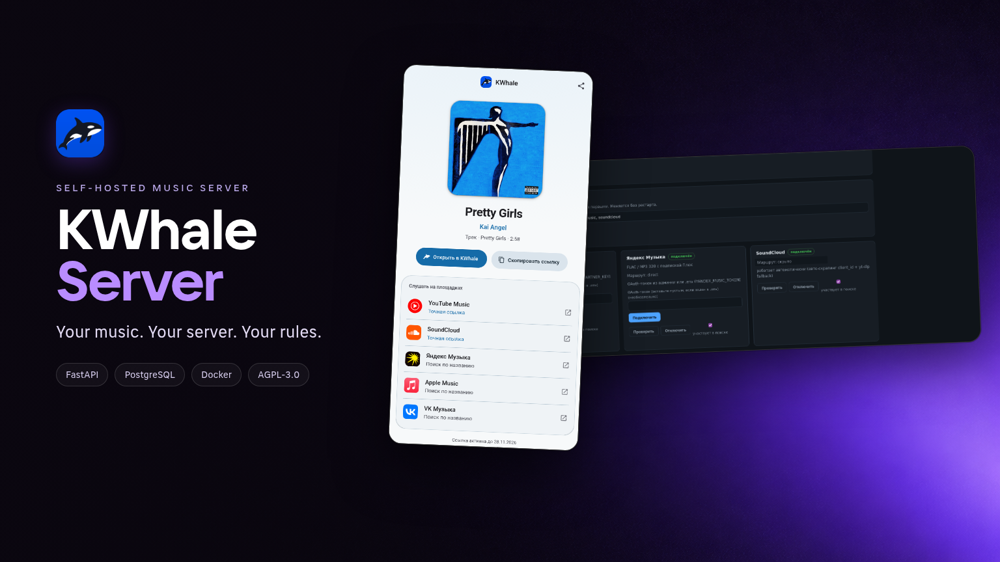
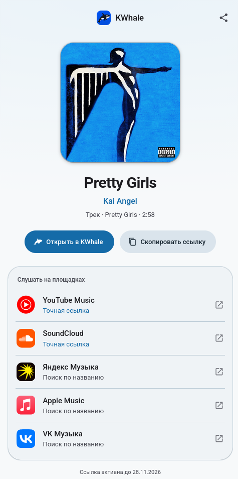
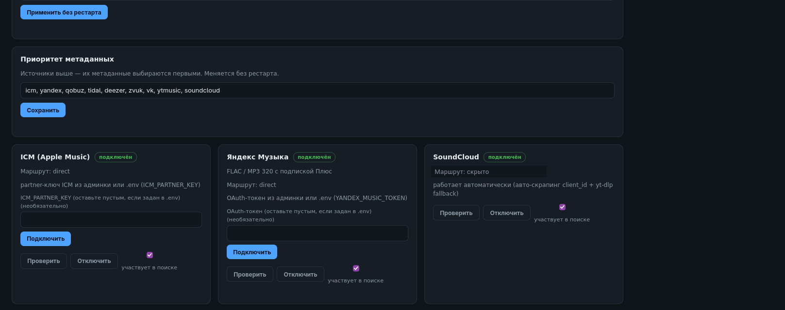

<div align="center">

**English** | [Русский](README.ru.md)

<br/>



# KWhale Server

**A self-hosted music backend — your catalogue, your rules.**

[](LICENSE)
[](https://www.python.org/)
[](https://fastapi.tiangolo.com/)
[](https://www.postgresql.org/)
[](https://github.com/KWhale-Music/kwhale-server/actions/workflows/ci.yml)

</div>

A FastAPI + PostgreSQL backend for your music library: one clean `/v1` API, catalogue,
playlists, streaming, sharing, AI recommendations and an admin panel. Built for
self-hosted Docker deployments and independent of external SaaS.

Part of the **KWhale** family:
[kwhale-android](https://github.com/KWhale-Music/kwhale-android) ·
[kwhale-desktop](https://github.com/KWhale-Music/kwhale-desktop) ·
[kwhale-agent](https://github.com/KWhale-Music/kwhale-agent)

## Features

- **One clean API** — `/v1` with a testable OpenAPI contract (drift tests in the suite):
  auth, catalogue, playlists, likes, events, library, downloads, mixes, sharing, scoring, admin.
- **Catalogue and local library** — tracks, albums, artists, playlists, favorites, history
  and downloads. Sources are connected through connectors.
- **Streaming** — LRU stream cache, HTTP Range / 206, full-body-only caching
  (a partial Range can never poison the cache), signed URLs stripped from logs.
- **AI recommendations** — taste model over events, prompt mixes
  (`/v1/mixes/prompt`), similar tracks, configurable scoring profiles.
- **Sharing** — canonical 7-day links with OpenGraph cards
  (images rendered on the server).
- **Admin panel** — sources, invites, roles, quality, recommendations and embed widgets.
- **Security** — scrypt with transparent rehash, JWT access + refresh tokens,
  AES-GCM envelopes for source credentials, fail-fast secret validation,
  a create-only seed admin, and GC/fsck that never eats playlist-pinned data.
- **Built for self-hosting** — one `docker-compose.yml`, PostgreSQL 16, no external SaaS.

## Screenshots

<div align="center">

</div>

<br/>



## Quick start

```bash
git clone https://github.com/KWhale-Music/kwhale-server.git
cd kwhale-server

cp .env.example .env
# generate secrets and put them into .env:
#   JWT_SECRET=$(openssl rand -hex 32)
#   POSTGRES_PASSWORD=$(openssl rand -hex 16)
#   ACCOUNTS_ENC_KEY=$(openssl rand -hex 32)
#   SEED_PASSWORD=<a strong password for the first admin>

docker compose up -d

# API on http://127.0.0.1:19001 — docs at /docs, contract at /openapi.json
```

Production runs **only through Docker Compose**. Running without Docker is not
supported and is not tested.

Tests always use the isolated `kwhale_test` database (never the production one):

```bash
cd server
python3 -m venv .venv && .venv/bin/pip install -e ".[dev]"
.venv/bin/python -m pytest
```

## Configuration

Everything is environment-based (see `.env.example`):

| Variable | Purpose |
|---|---|
| `DATABASE_URL` | PostgreSQL DSN |
| `POSTGRES_PASSWORD` | PostgreSQL password; generate a random one |
| `JWT_SECRET` | access-token signing secret; generate with `openssl rand -hex 32`. Changing it invalidates all sessions |
| `ACCOUNTS_ENC_KEY` | AES-GCM key for source credentials; generate with `openssl rand -hex 32`. Changing it makes existing source accounts unreadable |
| `SEED_USERNAME` / `SEED_PASSWORD` / `SEED_EMAIL` | bootstrap admin (create-only, never overwrites) |
| `APP_ENV=production` / `STRICT_SECRETS=1` | fail fast on dev-grade secrets |
| `CORS_ORIGINS` | allowed origins (Bearer API — credentials stay off) |
| `STREAM_CACHE_MAX_MB` / `STREAM_CACHE_TTL_HOURS` | stream cache budget |
| `PROXY_ENABLED`, `SOURCE_PROXY_DEFAULT`, `VPN_PROXY` | optional sing-box / per-source proxy routing |

## Connectors

The public server **does not ship ready-made connectors** to third-party music services:
those work through external APIs under each service's terms. The repository keeps the
connector contract (`server/app/connectors/base.py`) and the registry; your connectors can
live in a local overlay (`server/app/connectors_local/`, gitignored) and stay out of the
public repository.

The complete guide to writing a connector for any service is the
[`kwhale-connectors`](https://github.com/KWhale-Music/kwhale-agent/tree/main/skills/kwhale-connectors)
skill in KWhale Agent. Use third-party APIs in accordance with their terms; the authors
take no responsibility for misuse.

## Architecture

```
server/app/
├── v1/            # HTTP routers (auth, catalogue, playlists, sharing, mixes, admin…)
├── connectors/    # Connector contract + registry; real connectors live in a local overlay
├── services/      # search, dedup, identity, streaming, share cards, GC/fsck, scoring
├── static/        # admin panel /admin
├── db.py          # asyncpg pool + schema migrations
└── config.py      # env settings + secret validation
```

## Status

Beta — used daily by the author against a real library (3,000+ local tracks / 47k+ catalogue entries).
The API is stable; migrations in `schema.sql` will keep evolving.

## License

[AGPL-3.0](LICENSE) — you can run, modify and share the server, but if you offer it as a
network service, you must share your modifications under the same license.

Fonts are excluded: **Roboto** (Apache-2.0) and **DejaVu Sans** (Bitstream Vera / DejaVu)
remain under their own licenses and are not covered by the AGPL.
