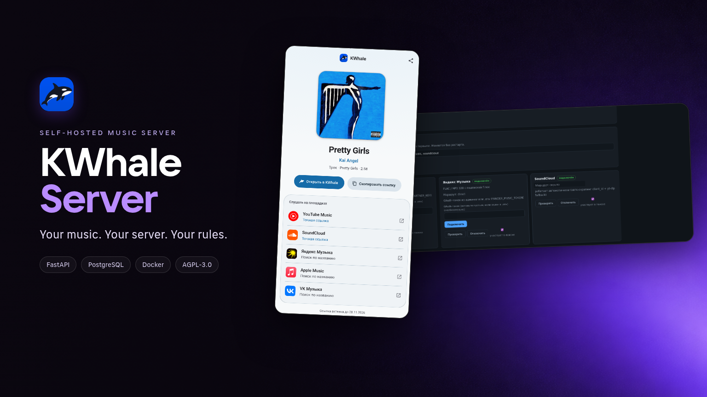
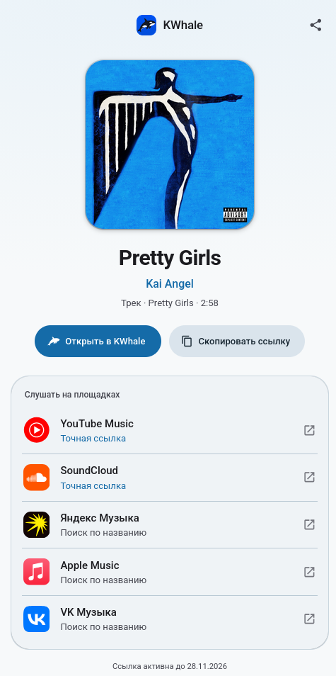
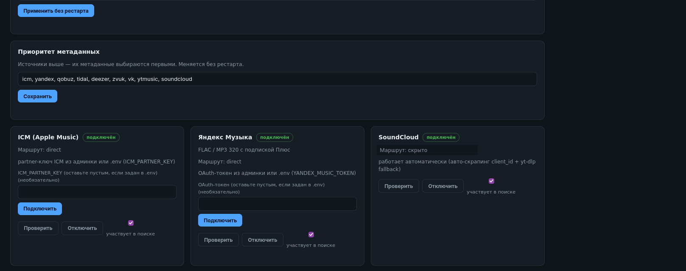

<div align="center">

[English](README.md) | **Русский**

<br/>



# KWhale Server

**Self-hosted музыкальный бэкенд — свой каталог, свои правила.**

[](LICENSE)
[](https://www.python.org/)
[](https://fastapi.tiangolo.com/)
[](https://www.postgresql.org/)
[](https://github.com/KWhale-Music/kwhale-server/actions/workflows/ci.yml)

</div>

Бэкенд на FastAPI + PostgreSQL для вашей музыкальной библиотеки: один чистый API `/v1`,
каталог, плейлисты, стриминг, шеринг, AI-рекомендации и админ-панель. Сервер рассчитан
на self-hosted запуск в Docker и не зависит от внешних SaaS.

Часть семьи **KWhale**:
[kwhale-android](https://github.com/KWhale-Music/kwhale-android) ·
[kwhale-desktop](https://github.com/KWhale-Music/kwhale-desktop) ·
[kwhale-agent](https://github.com/KWhale-Music/kwhale-agent)

## Возможности

- **Один чистый API** — `/v1` с тестируемым OpenAPI-контрактом (drift-тесты в тест-сьюте):
  auth, каталог, плейлисты, лайки, события, библиотека, загрузки, миксы, шеринг, скоринг, админка.
- **Каталог и локальная библиотека** — треки, альбомы, исполнители, плейлисты, избранное,
  история и загрузки. Источники подключаются коннекторами.
- **Стриминг** — LRU-кэш стримов, HTTP Range / 206, кэширование только полных тел
  (частичный Range не может отравить кэш), подписанные URL вычищаются из логов.
- **AI-рекомендации** — вкусовая модель на событиях, миксы по промпту
  (`/v1/mixes/prompt`), похожие треки, настраиваемые скоринг-профили.
- **Шеринг** — канонические 7-дневные ссылки с OpenGraph-карточками
  (картинки рендерятся на сервере).
- **Админ-панель** — источники, инвайты, роли, качество, рекомендации и embed-виджеты.
- **Безопасность** — scrypt с прозрачным апгрейдом старых хэшей, JWT access + refresh,
  AES-GCM envelope для учёток источников, fail-fast валидация секретов,
  seed-админ только создаёт, GC/fsck никогда не ест данные, закреплённые плейлистами.
- **Заточено под self-hosted** — один `docker-compose.yml`, Postgres 16, никаких внешних SaaS.

## Скриншоты

<div align="center">

</div>

<br/>



## Быстрый старт

```bash
git clone https://github.com/KWhale-Music/kwhale-server.git
cd kwhale-server

cp .env.example .env
# сгенерируйте секреты и впишите их в .env:
#   JWT_SECRET=$(openssl rand -hex 32)
#   POSTGRES_PASSWORD=$(openssl rand -hex 16)
#   ACCOUNTS_ENC_KEY=$(openssl rand -hex 32)
#   SEED_PASSWORD=<сильный пароль первого админа>

docker compose up -d

# API на http://127.0.0.1:19001 — docs на /docs, контракт на /openapi.json
```

Продакшен запускается **только через Docker Compose**. Запуск без Docker не
поддерживается и не тестируется.

Тесты всегда идут в изолированную БД `kwhale_test` (никогда — в боевую):

```bash
cd server
python3 -m venv .venv && .venv/bin/pip install -e ".[dev]"
.venv/bin/python -m pytest
```

## Конфигурация

Всё через переменные окружения (см. `.env.example`):

| Переменная | Назначение |
|---|---|
| `DATABASE_URL` | DSN PostgreSQL |
| `POSTGRES_PASSWORD` | пароль PostgreSQL; сгенерируйте случайный |
| `JWT_SECRET` | секрет подписи access-токенов; сгенерируйте `openssl rand -hex 32`. Смена инвалидирует все сессии |
| `ACCOUNTS_ENC_KEY` | ключ AES-GCM для учёток источников; сгенерируйте `openssl rand -hex 32`. Смена делает старые учётки нечитаемыми |
| `SEED_USERNAME` / `SEED_PASSWORD` / `SEED_EMAIL` | bootstrap-админ (только создание, никогда не перезаписывает) |
| `APP_ENV=production` / `STRICT_SECRETS=1` | падать на dev-секретах |
| `CORS_ORIGINS` | разрешённые origins (Bearer API — credentials выключены) |
| `STREAM_CACHE_MAX_MB` / `STREAM_CACHE_TTL_HOURS` | бюджет кэша стримов |
| `PROXY_ENABLED`, `SOURCE_PROXY_DEFAULT`, `VPN_PROXY` | опциональный sing-box / прокси-роутинг по источникам |

## Коннекторы

Публичная версия сервера **не содержит готовых коннекторов** к сторонним музыкальным
сервисам: они работают с внешними API на условиях этих сервисов. В репозитории остаётся
контракт `server/app/connectors/base.py` и registry; свои коннекторы можно держать в
локальном overlay (`server/app/connectors_local/`, gitignored) и не коммитить в публичный репозиторий.

Полное руководство по созданию коннектора под любой сервис — скилл
[`kwhale-connectors`](https://github.com/KWhale-Music/kwhale-agent/tree/main/skills/kwhale-connectors)
в KWhale Agent. Используйте сторонние API в соответствии с их условиями; авторы не несут
ответственности за ненадлежащее использование.

## Архитектура

```
server/app/
├── v1/            # HTTP-роутеры (auth, каталог, плейлисты, шеринг, миксы, админка…)
├── connectors/    # контракт Connector + registry; готовые коннекторы — локальный overlay
├── services/      # поиск, дедуп, идентичность, стриминг, шеринг-карточки, GC/fsck, скоринг
├── static/        # админ-панель /admin
├── db.py          # asyncpg-пул + миграции схемы
└── config.py      # env-настройки + валидация секретов
```

## Статус

Бета — автор использует ежедневно на реальной библиотеке (3 000+ локальных треков / 47k+ в каталоге).
API стабилен; миграции в `schema.sql` продолжат развиваться.

## Лицензия

[AGPL-3.0](LICENSE) — можно запускать, изменять и распространять сервер, но если
предлагаете его как сетевой сервис — обязаны выкладывать свои изменения под той же лицензией.

Исключение — шрифты: **Roboto** (Apache-2.0) и **DejaVu Sans** (Bitstream Vera / DejaVu)
остаются под своими лицензиями и не покрываются AGPL.
